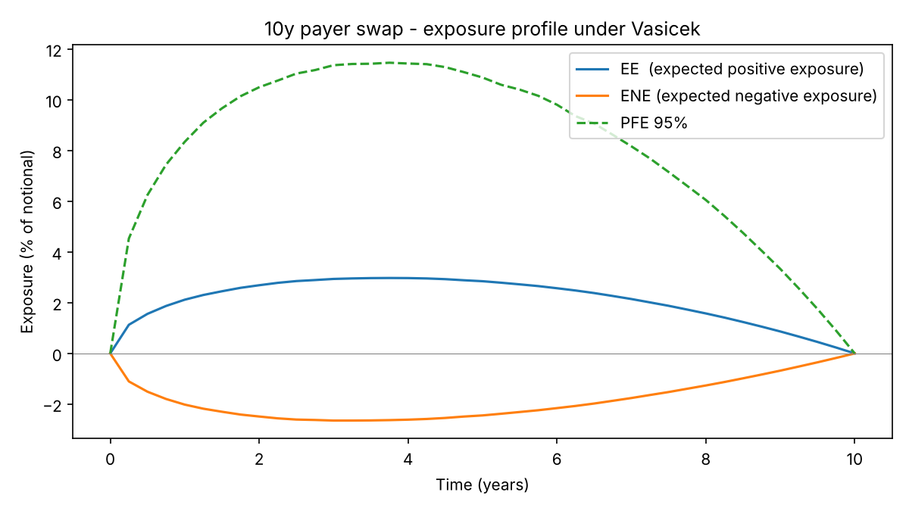

# XVA of an interest rate swap (CVA, DVA, FVA)

Monte Carlo computation of the valuation adjustments of a 10-year payer interest rate swap
under the Vasicek short-rate model, with a study of collateral and wrong-way risk.



## Method

1. **Rates.** Short rate `dr = a(b - r)dt + sigma dW`, simulated with the exact Gaussian
   transition and antithetic variates (40,000 paths, 240 time steps).
2. **Swap revaluation.** At each quarterly date the swap is repriced on every path with the
   closed-form Vasicek zero-coupon bond price: `V(t) = 1 - P(t,T_n) - K * delta * sum P(t,T_j)`.
   The fixed rate `K` is the par rate, so `V(0) = 0`.
3. **Exposure.** `EE(t) = E[max(V,0)]`, `ENE(t) = E[max(-V,0)]`, `PFE 95%` = 95th percentile of `V`.
4. **Adjustments.**
   - `CVA = (1 - R_C) * sum E[D(0,t) V+(t)] * dPD_C(t)`
   - `DVA = (1 - R_B) * sum E[D(0,t) V-(t)] * dPD_B(t)`
   - `FVA = sum (s_borrow * E[D V+] - s_lend * E[D V-]) * dt`

   Default probabilities come from a constant hazard rate `lambda = spread / (1 - R)`.
5. **Collateral.** A CSA threshold `H` caps the exposure at `min(V+, H)`.
6. **Wrong-way risk.** The default intensity is made stochastic and correlated with rates:
   `lambda_t = lambda_0 * exp(beta * z_t - beta^2 / 2)`, with `z_t` the standardised short rate.
   Its mean stays `lambda_0`, so only the dependence changes, not the average credit quality.

## Results

Parameters: `a = 0.10`, `b = 3%`, `sigma = 1%`, `r0 = 2.5%`; counterparty spread 150 bps,
bank spread 60 bps, recovery 40%; funding spreads 50 / 20 bps. Seed 42.

| Check | Value |
|---|---|
| `P(0,10y)` Monte Carlo vs closed form | 0.77114 vs 0.77106 (error 0.010%) |
| Par swap rate | 2.6062% |

| Adjustment | bps of notional |
|---|---|
| CVA | 24.57 |
| DVA | 10.03 |
| FVA | 5.58 |
| Total (-CVA + DVA - FVA) | -20.12 |

| CSA threshold (% of notional) | CVA (bps) | Reduction |
|---|---|---|
| none | 24.57 | - |
| 5.0% | 18.28 | 25.6% |
| 2.0% | 9.72 | 60.4% |
| 1.0% | 5.36 | 78.2% |
| 0.5% | 2.82 | 88.5% |

| beta (rates / default dependence) | CVA (bps) | vs independent |
|---|---|---|
| -0.5 (right-way) | 13.38 | -45.5% |
| 0.0 | 24.57 | 0.0% |
| +0.5 (wrong-way) | 38.79 | +57.9% |
| +1.0 (wrong-way) | 52.31 | +112.9% |

A payer swap gains value when rates rise. If the counterparty's credit also worsens when
rates rise (`beta > 0`), exposure and default probability move together and the CVA doubles.

## Limitations

- One-factor Vasicek with constant parameters, not calibrated to a market curve; rates can go negative.
- Single-curve framework (same curve for discounting and forwards).
- Collateral is an instantaneous cap: no margin period of risk, no minimum transfer amount.
- Deterministic default intensity in the base case; no first-to-default effect between CVA and DVA.
- Exposure is measured on payment dates only.

## Run

```bash
pip install numpy matplotlib
python xva_swap.py
```

A detailed write-up is in `1_xva_interest_rate_swap.pdf`.
